# 🧩 Dokumentasi Arsitektur Komponen Frontend — TacticBoard

Dokumen ini berisi pemetaan lengkap seluruh komponen frontend aplikasi **TacticBoard**, hierarki komponen, state management, custom hooks, serta fungsi dan interaksi dari masing-masing komponen. File ini diletakkan di root direktori proyek (`/FRONTEND_COMPONENTS.md`) agar menjadi referensi terpusat tanpa mengganggu berkas build maupun source code di dalam folder `/frontend`.

---

## 🗺️ 1. Peta Hierarki Komponen (Component Tree)

```mermaid
graph TD
    App[App.jsx - Root State Orchestrator]
    
    %% Layout Components
    App --> Header[components/layout/Header.jsx]
    App --> PitchCanvas[components/pitch/PitchCanvas.jsx]
    App --> BottomBar[components/layout/BottomBar.jsx]
    App --> AllModals[components/modals/AllModals.jsx]
    
    %% Canvas Internal Floating Sidebars
    PitchCanvas --> PitchSidebar[components/layout/PitchSidebar.jsx]
    PitchCanvas --> RightSidebar[components/layout/RightSidebar.jsx]
    
    %% Modals
    AllModals --> RoleAssignModal[components/modals/RoleAssignModal.jsx]
    AllModals --> StyleModal[components/modals/StyleModal.jsx]
    AllModals --> AIChatModal[components/modals/AIChatModal.jsx]
    AllModals --> SaveTacticModal[components/modals/SaveTacticModal.jsx]
    AllModals --> LoadTacticModal[components/modals/LoadTacticModal.jsx]
    AllModals --> RoleBrowserModal[components/modals/RoleBrowserModal.jsx]
    AllModals --> TutorialModal[components/modals/TutorialModal.jsx]
    AllModals --> ResetConfirmModal[components/modals/ResetConfirmModal.jsx]
```

---

## 🏛️ 2. Root Component: `App.jsx`

* **File:** [`frontend/src/App.jsx`](file:///c:/xampp/htdocs/Tacticbord/frontend/src/App.jsx)
* **Peran:** Pusat orkestrasi seluruh state aplikasi, rendering loop kanvas, event routing mouse/touch, dan penghubung antar hook.
* **Fungsi Utama:**
  1. **Pengatur Orientasi Responsif:** Mendeteksi perubahan orientasi layar (`portrait` vs `landscape`) menggunakan `window.matchMedia` dan memetakan sistem koordinat kanvas (`460×580` portrait atau `580×460` landscape).
  2. **Pitch Rendering Engine (`renderPitch`):** Menggambar seluruh lapisan lapangan sepak bola 2D di atas HTML5 Canvas (strip rumput, garis regulasi FIFA, zona taktis, passing network lines, pion tim utama, dan pion lawan).
  3. **Pengelolaan State Utama:**
     * `players`: Array posisi pion pemain (id, x, y, cx, cy, posType, role, rosterPlayerName).
     * `enemies`: Array pion lawan (posisi, tipe posisi, garis putus-putus merah).
     * `assignedRoles`: Peta penugasan peran taktis untuk setiap pemain.
     * `activeStyleId`: Preset gaya bermain aktif (misal *Tiki-Taka*, *Gegenpressing*).
     * `curFId`: ID formasi aktif (4-3-3, 4-2-3-1, 3-5-2, dll).
  4. **Interaksi Reset Aman:** Fitur tahan tombol reset selama 1 detik (`startHoldReset`, `cancelHoldReset`) dengan indikator progress bar animasi.

---

## 📐 3. Komponen Layout (`components/layout/`)

### 3.1 `Header.jsx`
* **File:** [`frontend/src/components/layout/Header.jsx`](file:///c:/xampp/htdocs/Tacticbord/frontend/src/components/layout/Header.jsx)
* **Props:**
  * `curFId` *(string)*: ID formasi yang sedang aktif.
  * `changeFormation` *(function)*: Handler untuk berganti formasi baku.
  * `activeStyleId` *(string|null)*: ID gaya bermain aktif jika ada.
  * `setIsStyleModalOpen` *(function)*: Pembuka modal pilihan preset gaya bermain.
  * `clearStyle` *(function)*: Fungsi melepaskan gaya bermain aktif.
  * `isSettingsOpen` *(boolean)*: State dropdown menu kanan atas.
  * `setIsSettingsOpen` *(function)*: Toggle dropdown menu.
  * `setIsAIChatOpen` *(function)*: Pembuka modal asisten taktik AI.
* **Fungsi & Fitur:**
  * Menampilkan logo dan identitas **TacticBoard**.
  * Dropdown seleksi formasi cepat (4-3-3, 4-4-2, 4-2-3-1, 4-1-3-2 Diamond, 3-5-2, 3-4-3, 5-4-1).
  * Tombol trigger preset taktis dengan indikator badge gaya aktif serta tombol cepat lepas gaya (tanda silang).
  * Tombol menu aksi cepat untuk memanggil **Asisten Taktik AI**.

---

### 3.2 `PitchSidebar.jsx` (Sidebar Kiri Melayang)
* **File:** [`frontend/src/components/layout/PitchSidebar.jsx`](file:///c:/xampp/htdocs/Tacticbord/frontend/src/components/layout/PitchSidebar.jsx)
* **Props:**
  * `phase` *(string)*: Fase taktik simulasi aktif (`possession`, `transition_pos`, `transition_neg`, `defense`).
  * `triggerPhase` *(function)*: Memicu transisi animasi pion sesuai fase taktik.
  * `simSpd` *(number)*: Kecepatan simulasi (0.5×, 1×, 2×).
  * `setSimSpd` *(function)*: Setter kecepatan simulasi.
  * `overlays` *(object)*: Flag visibilitas overlay `{ zone: boolean, pass: boolean }`.
  * `setOverlays` *(function)*: Setter overlay visual.
  * `zoom` *(number)*: Tingkat zoom kanvas saat ini (0.5× – 2.5×).
  * `setZoom` *(function)*: Setter zoom kanvas.
* **Fungsi & Fitur:**
  * **Dual State:** Dapat diciutkan menjadi kapsul mini (48px) atau diperluas (180px) dengan transisi mulus.
  * **Kontrol Fase Taktik:** 4 tombol fase (*In Poss* [Biru], *Counter* [Amber], *Press* [Ungu], *Out Poss* [Merah]) dengan dot neon.
  * **Kecepatan Simulasi:** Segmented pill tombol `0.5×`, `1×`, dan `2×`.
  * **Toggle Overlay:**
    * `Zona`: Menampilkan 5 pita horizontal area lapangan (Defensive, Midfield, Attacking Third).
    * `Pass`: Menghubungkan pemain yang berdekatan (<160px) dengan garis passing visual otomatis.
  * **Zoom Control:** Tombol `+`, `-`, reset cepat `1.0×`, dan progress bar persentase zoom.

---

### 3.3 `RightSidebar.jsx` (Sidebar Kanan Melayang)
* **File:** [`frontend/src/components/layout/RightSidebar.jsx`](file:///c:/xampp/htdocs/Tacticbord/frontend/src/components/layout/RightSidebar.jsx)
* **Props:**
  * `roster` *(array)*: Daftar pemain tim yang tersimpan di database lokal.
  * `addPlayer`, `addPlayers`, `updatePlayer`, `deletePlayer` *(functions)*: CRUD anggota tim.
  * `scenario` *(object)*: Hook perekam animasi dan layer skenario taktik.
  * `setIsBrowserOpen`, `setIsSaveOpen`, `setIsLoadOpen` *(functions)*: Pembuka modal database role, simpan taktik, dan muat taktik.
* **Fungsi & Fitur:**
  * **Tab Skuad Tim (`roster`):**
    * Form input pemain baru: Nama, nomor punggung, kaki dominan (kanan/kiri), posisi taktis (CF, W, AM, CM, DM, WB, FB, CB, GK), dan status skuad (Utama/Cadangan).
    * Import & Export CSV: Mengimpor data tim massal dari file `.csv` serta fitur unduh template format CSV resmi.
    * Daftar pemain dengan indikator atribut dan aksi hapus cepat.
  * **Tab Perekam Skenario (`record`):**
    * Perekaman keyframe per layer: Menyimpan snapshot posisi pion dan goresan spidol pada langkah tertentu.
    * Pemutaran multi-layer: Menjalankan urutan transisi antar layer secara otomatis untuk mempresentasikan skema bola mati (*set piece*) atau serangan bertahap.
  * **Aksi Bawah:** Pintasan membuka ensiklopedia peran (*Role Database*), *Save Tactic*, dan *Load Tactic*.

---

### 3.4 `BottomBar.jsx` (Toolbar Alat Gambar Bawah)
* **File:** [`frontend/src/components/layout/BottomBar.jsx`](file:///c:/xampp/htdocs/Tacticbord/frontend/src/components/layout/BottomBar.jsx)
* **Props:**
  * `drawTool` *(string)*: Alat aktif (`select`, `pen`, `arrow`, `dash`, `curve`, `line`).
  * `setDrawTool` *(function)*: Mengubah mode alat gambar.
  * `drawColor` *(string)*: Kode warna hex goresan aktif.
  * `setDrawColor` *(function)*: Mengubah warna goresan.
  * `clearDrawings` *(function)*: Membersihkan seluruh coretan di kanvas.
  * `undoDrawing` *(function)*: Menghapus goresan terakhir (undo stack).
  * `isHoldingReset`, `startHoldReset`, `cancelHoldReset`, `resetHoldProgress` *(props)*: State penanganan tombol tahan reset formasi.
* **Fungsi & Fitur:**
  * Seleksi mode: Pointer kursor geser pion vs 5 ragam alat spidol taktis.
  * **Color Picker Popover Cerdas:** Pemilih warna mengambang yang kompak (Kuning, Putih, Merah, Biru, Hijau).
  * Tombol Undo & Bersihkan Coretan.
  * **Web Share API Integration:** Berbagi formasi dan tautan taktik langsung ke aplikasi lain atau salin ke clipboard.
  * **Hold-to-Reset Button:** Mencegah reset formasi yang tidak sengaja dilakukan dengan mekanisme tekan-tahan 1 detik beranimasi bar.

---

## ⚽ 4. Komponen Arena Lapangan (`components/pitch/`)

### 4.1 `PitchCanvas.jsx`
* **File:** [`frontend/src/components/pitch/PitchCanvas.jsx`](file:///c:/xampp/htdocs/Tacticbord/frontend/src/components/pitch/PitchCanvas.jsx)
* **Peran:** Kontainer kanvas interaktif ganda (Main Canvas + Drawing Canvas) serta pembungkus sidebar melayang.
* **Fungsi & Fitur:**
  1. **Dual Canvas Architecture:**
     * `mcRef` (*Main Canvas*): Bertanggung jawab merender lapangan, pola rumput, garis lapangan, passing mesh, zona taktis, dan pion pemain.
     * `drawcRef` (*Drawing Canvas*): Kanvas transparan di atas kanvas utama yang khusus merender coretan spidol, panah lari, panah umpan, dan garis tanpa memicu re-render elemen lapangan statis.
  2. **Device Pixel Ratio (DPR) Scaling Cerdas:** Otomatis menghitung rasio layar dengan batas atas (*clamp*) `max 3.0` untuk mencegah Out of Memory (OOM) pada monitor 4K/Retina.
  3. **Penanganan Sentuhan Multi-Platform:** Menangani touch gesture seluler dengan flag `{ passive: false }` untuk mencegah layar ikut terscroll saat menggambar atau menyeret pion.
  4. **Trash Zone (Zona Sampah):** Menyediakan area deteksi di bawah lapangan; jika pion pemain diseret ke arah ini, pion akan terhapus secara visual dari kanvas.
  5. **Auto Fit Container:** Menggunakan `ResizeObserver` untuk memastikan kanvas pas secara proporsional di dalam viewport tanpa menghasilkan scrollbar ganda.

---

## 🗂️ 5. Komponen Modal Dialog (`components/modals/`)

### 5.1 `AllModals.jsx`
* **File:** [`frontend/src/components/modals/AllModals.jsx`](file:///c:/xampp/htdocs/Tacticbord/frontend/src/components/modals/AllModals.jsx)
* **Fungsi:** Komponen wadah (*container wrapper*) yang mengelompokkan dan merender seluruh modal aplikasi dalam satu hierarki bersih dengan overlay z-index tinggi.

### 5.2 `RoleAssignModal.jsx`
* **File:** [`frontend/src/components/modals/RoleAssignModal.jsx`](file:///c:/xampp/htdocs/Tacticbord/frontend/src/components/modals/RoleAssignModal.jsx)
* **Fungsi:** Dialog konfigurasi 2 langkah (*two-step wizard*) saat sebuah pion diklik di lapangan:
  * **Langkah 1 (Pilih Peran):** Menampilkan seluruh peran taktis sepak bola yang valid untuk posisi tersebut (misal: CF -> *Target Forward, False Nine, Poacher, Complete Forward*), lengkap dengan deskripsi taktis dan contoh pemain bintang dunia.
  * **Langkah 2 (Pilih Pemain):** Memilih pemain nyata dari roster tim untuk ditempatkan pada pion tersebut (menampilkan nama, nomor punggung, dan kaki dominan).

### 5.3 `StyleModal.jsx`
* **File:** [`frontend/src/components/modals/StyleModal.jsx`](file:///c:/xampp/htdocs/Tacticbord/frontend/src/components/modals/StyleModal.jsx)
* **Fungsi:** Menampilkan katalog gaya bermain legendaris dunia (*Tiki-Taka*, *Gegenpressing*, *Counter Attack*, *Catenaccio*, dll.). Ketika salah satu gaya dipilih, sistem otomatis mengubah formasi dasar dan menyetel konfigurasi peran pemain yang selaras.

### 5.4 `AIChatModal.jsx`
* **File:** [`frontend/src/components/modals/AIChatModal.jsx`](file:///c:/xampp/htdocs/Tacticbord/frontend/src/components/modals/AIChatModal.jsx)
* **Fungsi:** Antarmuka obrolan asisten taktik bertenaga AI (Groq API). Modal ini mengirimkan konteks taktik aktif (formasi saat ini, peran yang sedang dipakai, dan gaya bermain) ke model LLM dan menampilkan saran strategi, analisis ruang, atau evaluasi kelemahan formasi.

### 5.5 `SaveTacticModal.jsx` & `LoadTacticModal.jsx`
* **Files:** [`SaveTacticModal.jsx`](file:///c:/xampp/htdocs/Tacticbord/frontend/src/components/modals/SaveTacticModal.jsx) & [`LoadTacticModal.jsx`](file:///c:/xampp/htdocs/Tacticbord/frontend/src/components/modals/LoadTacticModal.jsx)
* **Fungsi:** 
  * `SaveTacticModal`: Form input untuk memberi nama dan catatan khusus taktik sebelum disimpan ke penyimpanan lokal browser.
  * `LoadTacticModal`: Daftar peramban seluruh taktik yang pernah disimpan pengguna, dilengkapi tanggal pembuatan, tombol muat ke lapangan, dan opsi hapus.

### 5.6 `RoleBrowserModal.jsx`
* **File:** [`frontend/src/components/modals/RoleBrowserModal.jsx`](file:///c:/xampp/htdocs/Tacticbord/frontend/src/components/modals/RoleBrowserModal.jsx)
* **Fungsi:** Ensiklopedia taktis lengkap untuk mencari, memfilter, dan membaca penjelasan semua peran pemain sepak bola di setiap lini (Kiper, Lini Belakang, Gelandang, dan Penyerang).

### 5.7 `TutorialModal.jsx` & `ResetConfirmModal.jsx`
* **Files:** [`TutorialModal.jsx`](file:///c:/xampp/htdocs/Tacticbord/frontend/src/components/modals/TutorialModal.jsx) & [`ResetConfirmModal.jsx`](file:///c:/xampp/htdocs/Tacticbord/frontend/src/components/modals/ResetConfirmModal.jsx)
* **Fungsi:**
  * `TutorialModal`: Panduan interaktif singkat (*onboarding*) untuk pengguna baru yang menjelaskan cara geser pion, menggambar spidol, memilih gaya taktik, dan menjalankan simulasi.
  * `ResetConfirmModal`: Dialog konfirmasi untuk mereset seluruh posisi pion kembali ke formasi standar jika pengguna tidak memakai metode tekan-tahan tombol reset.

---

## 🪝 6. Custom Hooks & State Logic (`frontend/src/hooks/`)

| Hook | File Path | Fungsi Utama |
| :--- | :--- | :--- |
| **`usePitchZoom`** | [`hooks/usePitchZoom.js`](file:///c:/xampp/htdocs/Tacticbord/frontend/src/hooks/usePitchZoom.js) | Mengelola level perbesaran kanvas antara `0.5×` hingga `2.5×` dan fungsi reset ke ukuran normal. |
| **`useSimulation`** | [`hooks/useSimulation.js`](file:///c:/xampp/htdocs/Tacticbord/frontend/src/hooks/useSimulation.js) | Mengatur transisi animasi interpolasi posisi pion antar fase taktik (*build-up*, *progression*, *final third*) menggunakan `requestAnimationFrame`. |
| **`useDragAndDrop`** | [`hooks/useDragAndDrop.js`](file:///c:/xampp/htdocs/Tacticbord/frontend/src/hooks/useDragAndDrop.js) | Menghitung kalkulasi jarak sentuhan (`Math.hypot`), seleksi pion, penyeretan pion dengan koordinat normalisasi, serta deteksi zona sampah. |
| **`useDrawing`** | [`hooks/useDrawing.js`](file:///c:/xampp/htdocs/Tacticbord/frontend/src/hooks/useDrawing.js) | Mengatur state dan logika render alat anotasi: bebas (*pen*), panah lurus (*arrow*), panah umpan putus-putus (*dash*), panah lengkung (*curve*), garis (*line*), undo stack, dan redraw. |
| **`useAIChat`** | [`hooks/useAIChat.js`](file:///c:/xampp/htdocs/Tacticbord/frontend/src/hooks/useAIChat.js) | Menangani komunikasi HTTP ke backend AI proxy, riwayat percakapan, status loading (*chatBusy*), dan inject konteks papan. |
| **`useTacticStorage`**| [`hooks/useTacticStorage.js`](file:///c:/xampp/htdocs/Tacticbord/frontend/src/hooks/useTacticStorage.js) | Mengelola serialisasi data taktik ke `localStorage` (CRUD taktik tersimpan). |
| **`useTeamRoster`** | [`hooks/useTeamRoster.js`](file:///c:/xampp/htdocs/Tacticbord/frontend/src/hooks/useTeamRoster.js) | Mengelola database daftar pemain tim lokal (tambah manual, import CSV, hapus, update). |
| **`useScenario`** | [`hooks/useScenario.js`](file:///c:/xampp/htdocs/Tacticbord/frontend/src/hooks/useScenario.js) | Perekam multi-frame / multi-layer animasi taktis untuk peragaan skenario pergerakan bertahap. |

---

## 🛠️ 7. Layanan, Utilitas & Data Statis

* **`services/api.js`:** Klien HTTP untuk fetching data dari backend (formasi, master roles, preset gaya, dan endpoint chat AI).
* **`utils/helpers.js`:** Fungsi matematika grafis, pencerah warna hex (`lighten`), serta filter role berdasarkan tipe posisi pemain (`rolesForPlayer`).
* **`utils/matchupEngine.js`:** Mesin kalkulasi keunggulan jumlah pemain (*numerical superiority*), overload zona lapangan, serta evaluasi ruang duel melawan pion musuh.
* **`data/tacticData.js`:** Definisi lengkap data formasi koordinat dasar (4-3-3, 4-4-2, dll), warna posisi (`TC`), border (`TB`), label posisi (`POS_LABEL`), dan zona lapangan (`ZBANDS`).
* **`data/examples.js`:** Referensi contoh nama pemain legendaris dunia untuk setiap peran taktis sepak bola.

---

## 🔄 8. Aliran Data Aplikasi (Data Flow Summary)

1. **User Interaction:** Pengguna melakukan drag pada pion pemain atau memilih alat spidol pada `BottomBar`.
2. **Event Processing:** Pointer event ditangkap oleh `PitchCanvas`, dinormalisasi koordinatnya berdasarkan rasio landscape/portrait dan DPR aman.
3. **State Mutation:** Koordinat diperbarui di dalam hook `useDragAndDrop` atau `useDrawing`, yang kemudian memperbarui state `players` atau `drawingPaths` di `App.jsx`.
4. **Canvas Repaint:** `App.jsx` memanggil `renderPitch()` untuk menggambar ulang elemen lapangan dan pion, sementara `redrawDrawings()` memperbarui lapisan kanvas spidol di atasnya tanpa jeda.
5. **Persistence & Sync:** Data formasi, roster tim, dan skenario disimpan secara persist di `localStorage` melalui hook `useTacticStorage` dan `useTeamRoster`.
